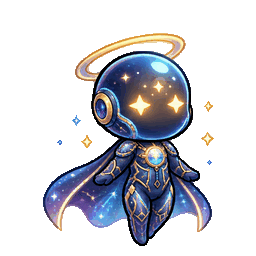

# KAGE — Mascot Spec

**A shadow carrying a light.**

KAGE is a palm-sized night creature that floats at the edge of the desktop and
shows what the current OpenCode session is doing. No panel, no text, no props.
Its face and its light are the interface.

*Visual target: keep this charm and silhouette, rebuild the detail for 40×40.*

Reference sheet: [six poses](mascot-ideas/Screenshot_2026-10-23_11-50-04.png).
Take the character, not the props; the other sheets are explorations.

This is a look book, not a feature list. When a rule and the charm disagree,
choose the charm.

## The character

One creature, one silhouette. Front view only; no turnaround and no 3/4 pose.

Personality: quiet, curious, a little proud. It leans toward work, perks up
when needed, and shrinks when something breaks.

- **Head** — a soft, dark orb, 22 × 19 px. The biggest shape by far.
- **Halo** — a thin gold oval, 28 × 6 px, floating 2 px above the head.
- **Body** — 10 × 9 px under the head, two stub feet, a short cape ending in one
  flick.
- **Face** — two 4 × 4 px eyes, 6 px apart, and a 2 px mouth.
- **Footprint** — 28 × 36 px inside a 40 × 40 frame. It floats; no ground shadow.
  Display at integer scale only: 4× by default, 2× minimum.

The head is twice the body height. If the body grows, the character stops being
cute.

**Construction** (source pixels, x/y from the top-left):

| Part | Box | Notes |
| --- | --- | --- |
| Halo | 6,2 → 33,7 | 1 px oval, rounded ends, 3 px overhang each side |
| Head | 9,10 → 30,28 | rounded, slightly wider than tall |
| Eyes | 13,18 and 23,18 | 4 × 4, 6 px gap |
| Mouth | 19,24 | 2 × 1 |
| Body | 15,28 → 24,36 | 1 px collar where the head meets the body |
| Cape | 11,29 → 28,37 | one flick to x29–30 at y31–33 |
| Feet | 16,37 and 22,37 | 2 × 1 each |

The glass orb is painted, not actually transparent. A real transparent head
would disappear on a busy wallpaper.

**Silhouette test:** fill it black. Halo, orb, cape flick and two feet must still
read. If a state needs a prop or a label to be understood, redesign the state.

## The one rule

**The creature is the shadow. The light is the status.**

The head, body, cape and stars never change color. The eyes and halo share
exactly one accent color, and that color is the state. This is what keeps a
whole status system from becoming a cast of mascots.

Offline is the only exception: the light goes out and the body desaturates.

## Palette

Eleven colors plus transparency. That is the whole palette.

| Role | Hex | Use |
| --- | --- | --- |
| Ink | `#05060B` | 1 px outline; never double it |
| Shade | `#0A1120` | cape, underside |
| Night | `#111A2E` | head fill |
| Dusk | `#182743` | body, collar |
| Rim | `#2B4470` | glass edge, upper left |
| Violet | `#7C6CF0` | static head stars only |
| Star | `#FFF4D6` | eye core, done flare, one glint |
| Gold | `#FFC978` | idle / waiting light |
| Ice | `#8FE7FF` | working / searching light |
| Ember | `#FF826E` | error light |
| Ash | `#6B7691` | offline only |

Rules:

- Light from the upper left: rim on top/left, shade on bottom/right.
- `Star` is the brightest pixel in the sprite. Never use it for a large area; it
  is a highlight, not a second status color.
- Violet stars are set dressing, not status.
- No gradients, glow, blur, anti-aliasing, or transparency inside the character.

## Face

Eyes carry the emotion; the mouth is a 2 px afterthought.

| Eyes | Shape | Used for |
| --- | --- | --- |
| Soft | 4×4 rounded, gold ring, 2×2 star core | idle |
| Focus | 4×3, ice, flat lower lid | working, searching |
| Wide | 5×5, star core, no ring | waiting |
| Flat | 4×2, ember, 1 px brow | error |
| Happy | 4×2 arc, star | done |
| Closed | 3×1 line, ash | offline |

Always give each open eye one bright pixel in the upper-left. It is the
difference between alive and LED.

- **Blink:** an overlay on any open-eye state, 90 ms every 4–6 s. Never in error
  or offline.
- **Mouth:** 2 px at y=24. Level by default, up 1 px for done, down 1 px for
  error. No open mouth, no teeth.

## States

Six states, three dials: light, halo, eyes. Plus one 0.7 s flourish. The body
does the acting.

| State | Light | Halo / accent | Eyes | Body | Loop |
| --- | --- | --- | --- | --- | --- |
| Idle | gold | level, slow bob | soft | floats 1 px, cape sways | 2 s float; blink overlay |
| Working | ice | level, one spark orbits the head | focus | leans 1 px in | 140 ms/f |
| Searching | ice | radar ring, expands 2 px | focus | still | 240 ms/f |
| Waiting | gold | pulses: rises and swells 1 px | wide | still | 2 pulses + hold, 4 s |
| Error | ember | tilts, breaks into 2 dashes | flat | sinks 1 px, cape droops | 450 ms/f |
| Done | star | flares 2 px wider | happy | one 1 px hop | 0.7 s, once |
| Offline | ash | flat line, no glow | closed | desaturated, no float | static |

- **Searching** is Working with a different halo. Do not draw a magnifying glass.
- **Waiting** pulses twice, then holds. Patient, not alarmed.
- **Done** plays once, then returns to idle. Never loop a celebration.
- Code names: waiting=`attention`, done=`celebrating`, offline=`disconnected`.

**State budget: 6 + 1.** `sleeping` and `waking` fold into idle; `tool_activity`
folds into working. `done` is a one-shot, not a state. If a new state needs new
body art, it is not a state — it is a different character.

## Motion

1. **Float, never bounce.** One pixel, slow. The body moves; the halo follows a
   frame later.
2. **Follow-through.** Cape and halo lag the body by one frame. It is the
   cheapest way to look polished.
3. **One accent at a time.** A spark, a radar ring, a pulse, or a flare. Never
   two.
4. **Blink like a creature, not a metronome.** Every 4–6 s, 90 ms.
5. **Reduced motion.** Hold frame one, keep the light color. Status still reads.
6. **Loop clean.** First and last frame must not pop.

## Six things that make it look good

1. **Big head, tiny body.** 2:1. No visible neck.
2. **One silhouette.** Halo, orb, cape flick, two feet. No ears, hats, arms, or
   costume changes.
3. **Two bright eyes.** Round, wide-set, one highlight each. The face is the
   whole charm.
4. **One accent color.** The body never changes hue. Six states, one light.
5. **Sparse detail.** Three stars max, one cape fold, one mouth line. Empty space
   is part of the design.
6. **Follow-through.** The cape and halo lag by a frame; the blink is irregular.
   That is what makes it feel alive.

## Don't

- No props: laptop, wrench, magnifier, hard hat, speech bubble, musical notes.
- No text, badges, exclamation marks, or UI chrome.
- No scenes, backdrops, or ground shadow.
- No gradients, outer glow, soft shadows, or more than one outline weight.
- No second mascot, no subagent variants.
- No tracing the reference sheets or the prototype GIF. They are direction, not
  source.

## Quality bar

- [ ] Silhouette test passes in every state.
- [ ] State reads in one second at 80 px (2×).
- [ ] Face is charming at 160 px (4×).
- [ ] Reads on white, black, and a busy wallpaper.
- [ ] Looks like a creature, not an app icon.
- [ ] You would leave it on your desktop all day.
- [ ] When in doubt, the cuter option wins.

## Boundaries

Observe only: no prompts or file contents, no input control, no approvals, no
network. Show idle when the event is unknown. KAGE is a status light with a
face, not a dashboard.

---

*The current build still uses the older ten-state cat sprite. This document is
the target for the redraw, not a description of the code.*
