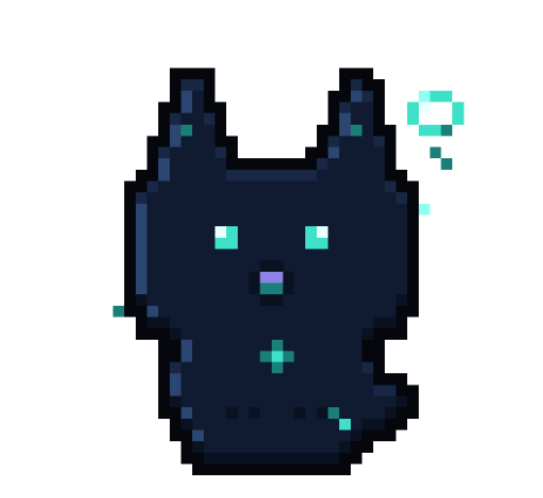

# KAGE

**A little spirit. A lot of signal.**

KAGE is a local-first pixel-art desktop companion for [OpenCode](https://opencode.ai).
It watches your coding session through a small OpenCode plugin and reflects what is
actually happening — working, running a tool, waiting for permission, failing, or
finishing — with its own animation language instead of another dashboard.

 

> Status: early alpha, Linux-first. Tested against OpenCode `2.1.2`.

## What it does

- **Real integration.** A TypeScript plugin observes documented OpenCode events
  (`session.status`, `session.idle`, `session.error`, tool hooks, permission events)
  and forwards normalized activity to the desktop app over a local Unix socket.
- **Animated pixel creature.** Nine hand-built states: sleeping, idle, waking,
  working, tool activity, attention, error, celebrating and disconnected.
- **Click to inspect.** Connection, session status, project, active tool, latest
  event, last error and session counts. Unknown values are shown as unavailable.
- **Settings** for size, opacity, animation intensity, reduced motion, optional
  sound and status details. Preferences persist locally.
- **Local only.** No account, no telemetry, no cloud, no network listener. The
  socket is authenticated with a per-run token that only your user can read.
- **Observes, never controls.** KAGE never reads your keyboard or mouse, injects
  input, or captures your screen. It only listens on a local socket.

## Requirements

- **Linux** desktop (primary; tested on Pop!_OS / GNOME; other compositors may
  affect transparency). **Windows** is supported as a beta (MSI/NSIS installer).
- [OpenCode](https://opencode.ai) installed and working (`opencode --version`).
- To build from source: Node.js 20+, Rust 1.77+, and the Tauri 2 Linux
  dependencies (WebKitGTK 4.1, GTK 3). Windows builds need the Rust MSVC
  toolchain.

## Install (end users)

No toolchain needed — grab a release. Three equivalent routes:

**1. One-liner (Linux, recommended)**

```bash
curl -fsSL https://raw.githubusercontent.com/Sanket758/KAGE/main/scripts/install.sh | bash
```

Downloads the latest AppImage to `~/.local/bin/KAGE.AppImage`, installs the
OpenCode plugin, and removes any legacy login-autostart entry from older
versions. Restart OpenCode afterwards.

**2. Debian / Ubuntu / Pop!_OS (.deb)**

Download `KAGE_*_amd64.deb` from the
[Releases](https://github.com/Sanket758/KAGE/releases) page, then:

```bash
sudo apt install ./KAGE_*_amd64.deb
```

The deb installs the `kage` binary (and its system libraries) but **not** the
OpenCode plugin — grab `kage.js` from the same release and drop it in
`~/.config/opencode/plugins/` (or run the one-liner above, which only installs
the plugin if the binary is already present). Restart OpenCode afterwards.

**3. Windows (beta)**

Download `KAGE_*_x64-setup.exe` (or the `.msi`) from
[Releases](https://github.com/Sanket758/KAGE/releases) and run it. Put
`kage.js` in `%USERPROFILE%\.config\opencode\plugins\` (or `opencode plugin add
github:Sanket758/KAGE`). OpenCode on Windows uses the same `.config` layout as
Linux/macOS, not `%APPDATA%`.

### Run

KAGE does **not** start at login. The OpenCode plugin launches it the moment a
session starts, and a managed instance exits about 10 seconds after OpenCode
stops. There is only ever one window, even with many sessions.

- Start OpenCode (`opencode` or `opencode serve`) — the mascot appears.
- Drag it by grabbing the sprite; right-click for the menu (skins, quit).
- Settings live in `~/.config/kage/settings.json` and persist locally.
- To quit manually: right-click → Quit, or `pkill -x kage`.
- Launching the binary directly (without OpenCode) keeps it open for about 60
  seconds unless a client connects; pass `--manual` to keep it open.

### Uninstall

```bash
bash install.sh --uninstall          # removes app, plugin, legacy autostart entry
# or, for the .deb:
sudo apt remove kage
```

Troubleshooting: [docs/TROUBLESHOOTING.md](docs/TROUBLESHOOTING.md).

The rest of this README is for building from source.

## Build from source

```bash
npm install
npm run dev            # starts Vite + the Tauri window (dev mode)
```

Release binary:

```bash
npm run build --workspace @kage/desktop   # frontend
cd apps/desktop/src-tauri && cargo build --release
# binary: apps/desktop/src-tauri/target/release/kage
```

Debian package + AppImage:

```bash
cd apps/desktop
npm run tauri:build -- --bundles deb,appimage
# → target/release/bundle/deb/KAGE_0.3.4_amd64.deb
# → target/release/bundle/appimage/KAGE_0.3.4_amd64.AppImage
```

The packages depend on `libwebkit2gtk-4.1-0` and `libgtk-3-0`.

The KAGE window is frameless, transparent where the compositor supports it, and
always on top. Click the creature to inspect status.

## Install the OpenCode plugin (from source)

```bash
npm run build:plugin
node scripts/install-plugin.mjs              # ~/.config/opencode/plugins/kage.js
# or, for one project only:
node scripts/install-plugin.mjs --project    # ./.opencode/plugins/kage.js
```

Restart OpenCode (or run `opencode service restart`). You can also point at the
built bundle explicitly in `opencode.json`:

```jsonc
{
  "plugins": ["./packages/opencode-plugin/dist/index.js"]
}
```

The plugin starts the companion when OpenCode runs and exits it when OpenCode's
server stops. It retries with bounded backoff and never blocks, throws into, or
slows the agent.

Try the animations without OpenCode using simulated events:

```bash
node scripts/simulate-events.mjs                    # working → edit → complete
node scripts/simulate-events.mjs --scenario permission
node scripts/simulate-events.mjs --scenario error
```

These scenarios are simulated fixtures, not a live OpenCode run.

## Where things live

| What | Path |
| --- | --- |
| Bridge socket | `$XDG_RUNTIME_DIR/kage/kage.sock` |
| Bridge token | `$XDG_RUNTIME_DIR/kage/token` (mode 0600) |
| Settings | `$XDG_CONFIG_HOME/kage/settings.json` |
| Instance lock | `$XDG_RUNTIME_DIR/kage/kage.lock` (Unix) |

## How it fits together

```text
OpenCode ── plugin (TS) ── normalized events ── Unix socket + token ──┐
                                                                     ▼
                                                     Tauri 2 shell (Rust)
                                                     validation · rate limits
                                                                     │
                                                     Svelte 5 + canvas UI
                                                     state machine · sprites
```

The state machine, event schema and settings validation live in `packages/core`
and are tested without a GUI or a running agent.

## Development

```bash
npm test                     # core, plugin and art tests (Node + Vitest)
npm run typecheck            # TypeScript
npm run preview:sprites      # terminal gallery of every animation
cd apps/desktop && npm run check   # Svelte + TypeScript checks
cd apps/desktop/src-tauri && cargo test --lib
```

See [docs/ARCHITECTURE.md](docs/ARCHITECTURE.md),
[docs/DEVELOPMENT.md](docs/DEVELOPMENT.md),
[docs/TESTING.md](docs/TESTING.md),
[docs/PERFORMANCE.md](docs/PERFORMANCE.md) and
[docs/TROUBLESHOOTING.md](docs/TROUBLESHOOTING.md), plus
[SECURITY.md](SECURITY.md).

## Known limitations

- Linux only for now. Transparency and always-on-top depend on the compositor;
  KAGE does not claim support for every desktop.
- The plugin does not know tool outcomes directly (`tool.execute.after` fires for
  both success and failure). Failures are reflected through `session.error`.
- An idle session is not treated as success; completion is only celebrated when
  OpenCode reports a genuine completion signal.
- Sound cues are intentionally minimal and off by default.

## License

MIT — see [LICENSE](LICENSE).
